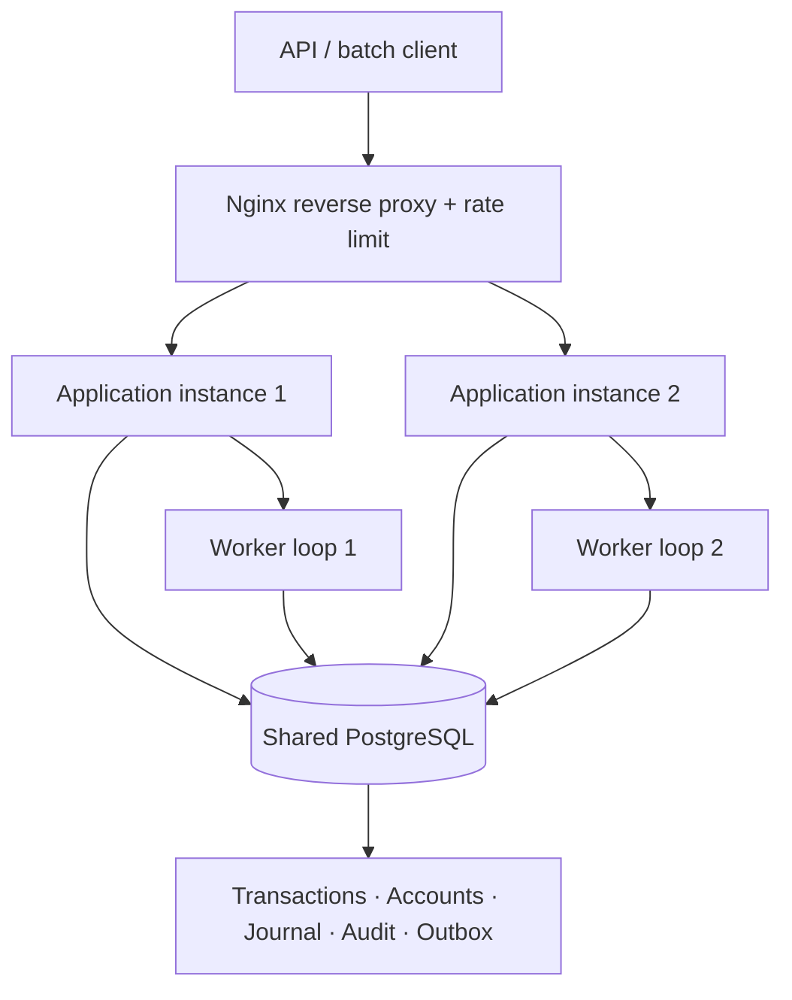

# Architecture and design decisions

## Goals

Implement the supplied FDE L2 requirements: durable ingestion, duplicate detection, idempotent effects, sequence-based out-of-order handling, retry-safe processing, transaction status lifecycle, processing summaries, and important edge-case tests. The database is the shared source of truth across replicas.

## Component diagram

## Why a relational database queue

The assessment does not require Kafka/RabbitMQ. Transaction work is already durable in PostgreSQL, so the initial implementation uses rows as a work queue. This reduces operational components while retaining database-enforced uniqueness and atomic financial updates. If throughput or queue retention exceeds database queue suitability, a broker can be introduced behind an adapter; the database transaction and idempotency boundary must remain authoritative.

## Multi-instance work claiming

Each node runs one scheduled worker. The worker opens a database transaction and claims an eligible transaction with `SELECT ... FOR UPDATE SKIP LOCKED`. The row lock is held until the same transaction commits or rolls back, so a second node skips the locked row. The worker then locks the account row `FOR UPDATE`, serializing sequence and balance changes for that account while allowing different accounts to proceed concurrently.

No database transaction is held while calling a network service. External effects are not performed in the posting transaction; an outbox event is persisted instead.

## Atomic posting boundary

For a successful transaction, one PostgreSQL transaction performs:

1. Claim and lock the transaction record.
2. Lock the account row.
3. Evaluate sequence, currency, business rule, and available balance.
4. Insert two immutable journal lines: customer and currency-specific clearing.
5. Update the materialized account balance and sequence cursor.
6. Mark the transaction `PROCESSED`.
7. Insert an audit record and transactional outbox event.
8. Commit.

If any step fails before commit, the database rolls back all effects. A retry can therefore safely re-evaluate the durable transaction. If commit succeeds but the client/worker loses the response, the unique identity and stored status let the retry discover the prior outcome rather than post again.

A deferred PostgreSQL constraint trigger checks that each journal has exactly two lines with equal non-zero total debits and credits. A separate trigger prevents journal line update/delete. Corrections are compensating transactions, never edits to historical entries.

## Idempotency

Two unique database constraints protect transaction ID and idempotency key. The service computes SHA-256 over a canonical business payload. Delivery-specific request ID and idempotency key are not part of the financial payload hash; this lets a legitimate retry use a different transport request ID without changing the business identity. The service separately checks the transaction ID and key identity to prevent one key from being reused for a different transaction.

The database constraint is the final race arbiter. Application-side read-before-write checks are only a fast path, not the correctness mechanism.

## Ordering policy

`last_consumed_sequence` is an account cursor. Sequences begin at 1 and are unique per account. A future sequence is marked `PENDING`; it becomes eligible when the cursor advances to its predecessor. A missing sequence is never skipped automatically.

When an expected sequence is evaluated and rejected for a permanent business reason (for example insufficient funds or currency mismatch), the record becomes `FAILED` with no journal posting, but the sequence cursor advances. This makes the event stream progress without treating the financial action as successful. Malformed requests rejected before durable ingestion do not consume a sequence, so the caller can correct and resubmit the missing event. This is a deliberate assumption and is covered in tests/documentation.

## Retry and recovery

- SQL states for connection failures, serialization failures, resource exhaustion, and transient SQL exceptions are classified as retryable.
- Retry count and `next_attempt_at` are persisted. Backoff grows exponentially, is capped, and adds jitter.
- Retry exhaustion moves a record to `DEAD_LETTER` for operator review.
- Unexpected non-retryable infrastructure failures are dead-lettered rather than misrepresented as business rejection.
- An operations-only redrive endpoint requeues dead-lettered records and resets the retry count; it does not mutate a processed transaction.
- If PostgreSQL is unavailable, retry metadata cannot be persisted until it returns. Since the posting transaction rolls back, the financial effect remains safe; the worker can retry after recovery.

## Reversals and double-entry model

This scope supports one full reversal per original processed CREDIT/DEBIT. The reversal must match original account, currency, and amount. Its reference is checked when its account sequence becomes eligible, so an out-of-order reversal request can remain pending until the original event arrives and posts. It posts the opposite customer-side amount with two balanced journal lines. Partial reversals and complex chargeback/dispute lifecycles are out of scope. The materialized balance is updated atomically with the journal.

## Outbox boundary

The posting transaction inserts an outbox event. There is intentionally no external broker publisher in this assessment build. Before downstream integration, implement a separately monitored outbox dispatcher that claims events durably, retries publication, and relies on consumer-side event ID deduplication. An outbox alone does not make external side effects exactly-once.

## Security boundary

The local assessment uses separate API and operations bearer tokens with constant-time comparison, bounded request bodies, safe client errors, a bounded HTTP executor, and Nginx request rate limiting. This is not a full identity platform. Production deployment must use TLS, managed secrets, OAuth2/OIDC or workload identity, role-scoped permissions, least-privilege database roles, and security review. Do not expose the local Compose stack directly to the internet.

## Observability

The app emits Java Util Logging events without request bodies or credentials. PostgreSQL stores processing audit records. `/v1/summary` exposes counts by status, duplicate submission count, and ledger transaction/line counts. Production rollout should add Micrometer/OpenTelemetry, queue-age and retry metrics, dashboards, alerts, and SLOs.

## Framework decision

The HTTP adapter uses JDK `HttpServer` rather than Spring MVC. This is a deliberate scope trade-off: the assessment API is small, the business/data boundary is explicit, and the production Java source can be compiled offline with strict warnings. HikariCP manages JDBC connections and Flyway manages migrations. Do not infer that the custom HTTP adapter provides all the features of Spring Boot; if the API expands, moving the adapter to Spring Boot is a reasonable evolution, but avoid running two competing application frameworks.

## Deployment topology

Local Compose starts one PostgreSQL primary, two app replicas, and Nginx. It demonstrates shared-state coordination, not high availability of the database. Production requires managed PostgreSQL HA, TLS, backups, point-in-time recovery, a controlled migration job, multiple app replicas, a secure ingress, capacity planning, and disaster recovery exercises.
